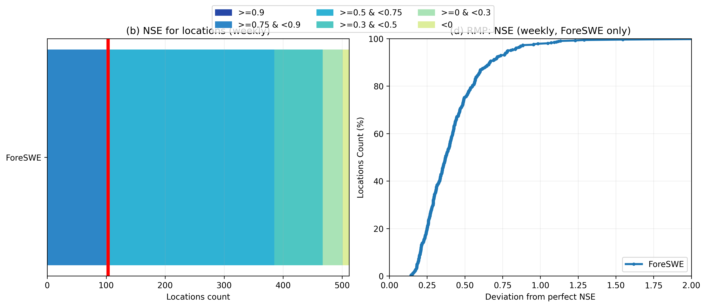

# ForeSWE-only Figure 3b/3d Reproduction

This partial reproduction uses only the finished weekly ForeSWE run.

- Weekly actuals: `/pscratch/sd/h/hyvchen/Snow-Predication-at-Sierra/experiments/foreswe_weekly_reproduction_full512/results/actual/*_weekly_window_actual.pkl`
- Weekly predictions: `/pscratch/sd/h/hyvchen/Snow-Predication-at-Sierra/experiments/foreswe_weekly_reproduction_full512/results/predict/*_weekly_gp_window_predict.pkl`
- Valid station count: `512`
- NSE bin counts: `[0, 103, 282, 82, 34, 11]`
- Station-level NSE table: `reproduced_fig3bd_weekly_foreswe_only_station_nse.csv`

Method summary:
- For each station, all weekly test windows from 2014-2018 were concatenated.
- Weekly NSE was computed by flattening all forecast windows and all 4 weekly horizons for that station.
- Panel (b) is the weekly NSE bin distribution for ForeSWE only.
- Panel (d) is a ForeSWE-only proxy for the paper's RMP view: it plots the cumulative distribution of `1 - NSE`, which is the deviation from a perfect NSE score of 1.0.
- Because the other comparison models were not rerun here, this is not the full cross-model RMP used in the paper.

